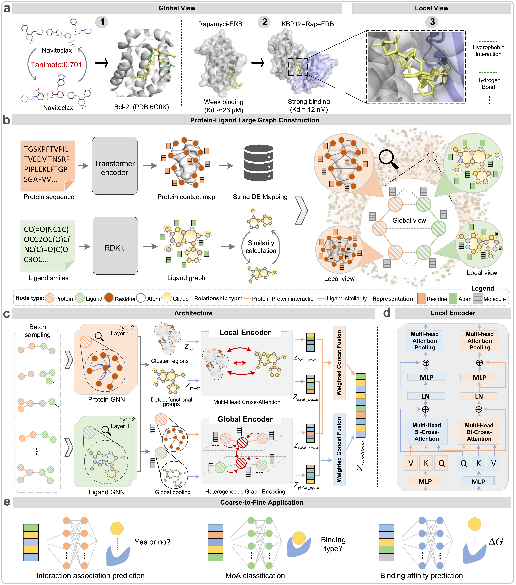

# InterMS

## Project Description

> Accurately predicting how small-molecules ligands bind to proteins and with what affinity is a critical task in drug discovery. However, most existing computational methods designed for this purpose primarily focus on local interaction patterns, often neglecting the broader global structural and functional context. This oversight significantly hinders their ability to model complex binding mechanisms. To address this limitation, we propose InterMS (Interaction-aware multi-scale Graph Neural Network). This novel framework uniquely integrates both local and global interaction information, enabling comprehensive and scalable protein–ligand modeling. InterMS effectively captures both fine-grained molecular contacts and long-range functional regulatory signals, providing a more complete understanding of intricate molecular interactions within biological systems. Extensive experiments on benchmark datasets demonstrate that InterMS consistently outperforms state-of-the-art methods across diverse prediction challenges. These include protein–ligand interaction prediction, mechanism-of-action classification, and binding affinity prediction. These results highlight InterMS's potential as a powerful, mechanism-aware tool for real-world drug discovery applications.


## Overview

InterMS is a graph learning framework for protein-ligand interaction prediction. It builds a heterogeneous graph over proteins and compounds, then combines:

- local structure modeling (residue-substructure interaction encoding), and
- global message passing on the heterogeneous graph.

Supported tasks:

| Task | Typical datasets | Decoder type | Loss |
|---|---|---|---|
| Regression | PDBBind 2016/2020, BindingDB | `regression` | `mse` |
| Binary classification | BioSNAP | `binary` | `bce` |
| Multi-class classification | Function | `multiclass` | `ce` |

## Repository Layout

```text
InterMS/
├── configs/                        # Dataset-specific configs
├── scripts/
│   ├── pipeline.py                 # Main train/eval pipeline
│   └── pipeline_for_experiment.py  # Train/eval + interpretability
├── src/
│   ├── model.py
│   ├── data.py
│   ├── pdbbind_dataset.py
│   ├── biological_properties.py
│   ├── chemical_properties.py
│   └── ...
├── data/                           # Datasets and generated graph artifacts
├── outputs/                        # Logs, CSV predictions, explainability outputs
├── ckpt/                           # Best checkpoints (<dataset_name>_model_best.pt)
└── environment.yaml                # Conda environment definition
```

## Data and Checkpoints (Hugging Face)

Dataset files and experiment checkpoints are available at:

- [shwtian/InterMS_dataset (Hugging Face)](https://huggingface.co/datasets/shwtian/InterMS_dataset/tree/main)

Recommended local mapping:

- `data/0.pdbbind2020/`
- `data/1.pdbbind2016/`
- `data/2.biosnap/`
- `data/3.function/`
- `data/4.bindingdb/`
- `data/9606.protein.physical.links.v12.0.txt`
- `data/Mapping_Uniprot2Ensp.csv`
- `data/Human_Protein.csv`
- `ckpt/` (copy pretrained checkpoints if you want evaluation-only runs)

If `ckpt/<dataset_name>_model_best.pt` exists, the pipeline loads it and directly runs test evaluation.  
If it does not exist, the pipeline trains and saves the best checkpoint to `ckpt/`.

## Environment and Dependency Versions

Create the environment from the project lock file:

```bash
conda env create -f environment.yaml
conda activate InterMS
```

Key versions (from `environment.yaml`):

| Dependency | Version |
|---|---|
| Python | 3.8.20 |
| PyTorch | 2.1.0 (`cuda12.1`) |
| torch-geometric | 2.6.1 |
| torch-scatter | 2.1.2 (`pt21cu121`) |
| fair-esm | 2.0.0 |
| RDKit | 2024.3.5 |
| Biopython | 1.83 |
| NumPy | 1.24.3 |
| pandas | 2.0.3 |
| scikit-learn | 1.3.2 |


### SSL note for ESM model download

On first-time graph construction, ESM weights may be downloaded automatically.  
If you hit `CERTIFICATE_VERIFY_FAILED`, update CA/certifi in your environment or pre-download weights into:

- `~/.cache/torch/hub/checkpoints/`

## Data-to-Graph Construction Flow

When processed files are missing, InterMS builds graph data automatically:

1. Read raw tables from dataset folders (`full.csv` and related files).
2. Build protein-protein and compound-compound relation edges.
3. Build/Cache protein small graphs:
   - generated via ESM-based features in `src/biological_properties.py`
   - saved as `<dataset_name>_protein_graphs.pt`
4. Build/Cache ligand small graphs:
   - generated via RDKit-based processing in `src/chemical_properties.py`
   - saved as `<dataset_name>_ligand_graphs.pt`
5. Build/Cache heterogeneous training graph:
   - saved as `<dataset_name>-data.pt` under each dataset folder.

These artifacts are then reused in subsequent runs.

## Train/Val/Test Protocol

Current behavior in both `scripts/pipeline.py` and `scripts/pipeline_for_experiment.py`:

- Train only on `train` edges.
- Evaluate every epoch on `val` edges.
- Select best checkpoint by validation metric:
  - Regression: lowest `RMSE`
  - Binary: highest `AUROC`
  - Multiclass: highest `Accuracy`
- After training, load the best checkpoint and evaluate once on `test`.

This avoids using test metrics for model selection.

## Input and Output Specification

### Inputs

1. **Config file** (`--config_file`), e.g. `configs/pdbbind2020_config.ini`
2. **Dataset files** under configured `RUNINFO.data_dir`
3. **Common files** referenced in `[INPUT_FILES]`:
   - `ppi_database`
   - `mapping_file`
   - `human_proteins`
4. **Optional checkpoint**:
   - `ckpt/<dataset_name>_model_best.pt`

### Outputs

- Training/evaluation log:
  - `outputs/<run_name>.log`
- Best checkpoint:
  - `ckpt/<dataset_name>_model_best.pt`
- Test prediction CSV:
  - generated next to the log file (`.csv`)
- Experiment pipeline extra outputs:
  - `outputs/explain_results/<dataset_name>/batch_x/protein/*.csv`
  - `outputs/explain_results/<dataset_name>/batch_x/ligand/*.csv`
  - `outputs/experiment_steps/<dataset_name>/results_epoch*.csv` (binary experiment logging)

## Configuration Example

Main fields in `configs/pdbbind2020_config.ini`:

- `[RUNINFO]`: dataset path/name, cpu/gpu behavior
- `[MODELINFO]`: encoder type, decoder/task type, hidden size, DiffPool clusters
- `[RUNPARAMS]`: seed, epochs, lr, batch size, neighbor sampling
- `[INPUT_FILES]`: paths to PPI/mapping/human protein files

## Run

From repository root:

```bash
conda activate self

# PDBBind 2020 (regression)
PYTHONPATH=. python scripts/pipeline.py --config_file configs/pdbbind2020_config.ini

# PDBBind 2016 (regression)
PYTHONPATH=. python scripts/pipeline.py --config_file configs/pdbbind2016_config.ini

# BioSNAP (binary)
PYTHONPATH=. python scripts/pipeline.py --config_file configs/biosnap_config.ini

# Function (multiclass)
PYTHONPATH=. python scripts/pipeline.py --config_file configs/function_config.ini

# BindingDB (regression)
PYTHONPATH=. python scripts/pipeline.py --config_file configs/bindingdb_config.ini
```

Experiment + interpretability:

```bash
PYTHONPATH=. python scripts/pipeline_for_experiment.py --config_file configs/biosnap_config.ini
```

## License

This project is released under [CC BY-NC-SA 4.0](http://creativecommons.org/licenses/by-nc-sa/4.0/).
